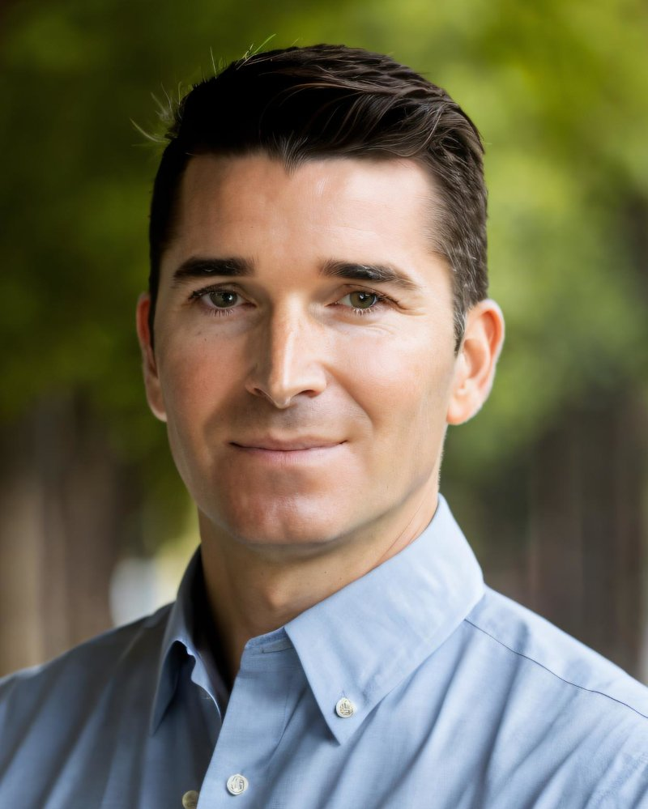

<section class="section">
  

    

      
Clearpoint è la mia attività di consulenza indipendente per PMI svizzere e organizzazioni in crescita. Riunisce tre aspetti spesso gestiti separatamente: comprendere i rischi di sicurezza, migliorare il modo di lavorare con agenti IA e automazione, e coordinare il cambiamento tecnico finché non è davvero operativo.

      
Il mio approccio è pratico. Traduco i risultati tecnici in decisioni che la direzione può prendere e che i team tecnici possono attuare, mantenendo strutturati perimetro, coordinamento e responsabilità lungo tutto il percorso.

      
Questa combinazione è utile tanto negli incarichi per i clienti quanto all’interno di un’organizzazione: ovunque sicurezza, strumenti, processi, persone coinvolte e realizzazione debbano essere gestiti insieme, anziché passare da un team all’altro senza un filo conduttore.

      

        <a class="button button--quiet" href="{{ site.linkedin_url }}">Collegati su LinkedIn</a>
        <a href="mailto:{{ site.email }}">{{ site.email }}</a>
      

    

    <figure class="portrait">
      
    </figure>
  

</section>

<section class="section" aria-labelledby="bring-title">
  

    

      <h2 id="bring-title">Il mio contributo</h2>
    

    <dl class="rows">
      

        <dt>Giudizio in materia di sicurezza</dt>
        <dd>Capire il rischio reale, verificare che cosa succede davvero e sistemare prima ciò che conta. Quando sorgono problemi, aiuto a coordinare le persone giuste. Le decisioni restano proporzionate, anziché checklist fini a sé stesse.</dd>
      

      

        <dt>Automazione responsabile</dt>
        <dd>Scegliere il lavoro ripetitivo che vale la pena delegare, costruirci attorno agenti IA e automazioni e mantenere sotto controllo dati, accessi, responsabilità e approvazione umana, perché il risultato resti facile da mantenere.</dd>
      

      

        <dt>Disciplina nella realizzazione</dt>
        <dd>Fare un piano realistico, mantenere visibili costi e avanzamento e accorgersi presto quando il progetto devia. A quel punto capirne la causa, presentare le opzioni e coordinare persone e fornitori fino al passaggio di consegne.</dd>
      

      

        <dt>Traduzione tra business e tecnologia</dt>
        <dd>Spiegare rischi tecnici e compromessi in termini di impatto, impegno e priorità, così che le decisioni possano essere prese con cognizione di causa.</dd>
      

    </dl>
  

</section>

<section class="section" aria-labelledby="work-title">
  

    

      <h2 id="work-title">Come lavoro</h2>
    

    

      

        
Il lavoro inizia chiarendo il problema, prima di intervenire su sistemi o documenti:

        <ul class="plain-list">
          <li>che cosa va risolto, e perché proprio ora;</li>
          <li>quale rischio o attrito genera;</li>
          <li>quali sistemi e stakeholder sono coinvolti;</li>
          <li>quale potrebbe essere un prossimo passo utile;</li>
          <li>che cosa è realistico con le risorse disponibili.</li>
        </ul>
      

      

        
Alcuni principi restano costanti:

        <ul class="plain-list">
          <li><strong>Proporzionato</strong>: l’impegno corrisponde al rischio reale.</li>
          <li><strong>Indipendente</strong>: la consulenza non è legata alla vendita di un prodotto o di un pacchetto di un fornitore.</li>
          <li><strong>Documentato</strong>: decisioni, responsabilità e prossimi passi vengono messi per iscritto.</li>
          <li><strong>Condiviso</strong>: direzione e team tecnici lavorano sulla stessa base.</li>
        </ul>
        
Per incarichi più ampi o specialistici è possibile coinvolgere competenze aggiuntive da una rete di fiducia, mantenendo chiari perimetro, coordinamento e responsabilità.

      

    

  

</section>

<section class="section" aria-labelledby="about-cta-title">
  

    <h2 id="about-cta-title">Parliamone</h2>
    
Che stiate valutando un mandato di consulenza, un progetto o un ruolo all’incrocio tra sicurezza, automazione e realizzazione, una breve conversazione è un buon punto di partenza.

    

      <a class="button" href="{{ site.booking_url }}">Prenota un incontro</a>
      <a class="link-arrow" href="{{ site.linkedin_url }}">Profilo LinkedIn→</a>
    

  

</section>
